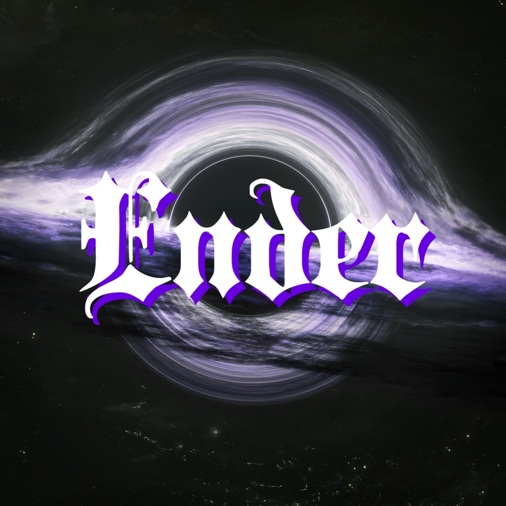
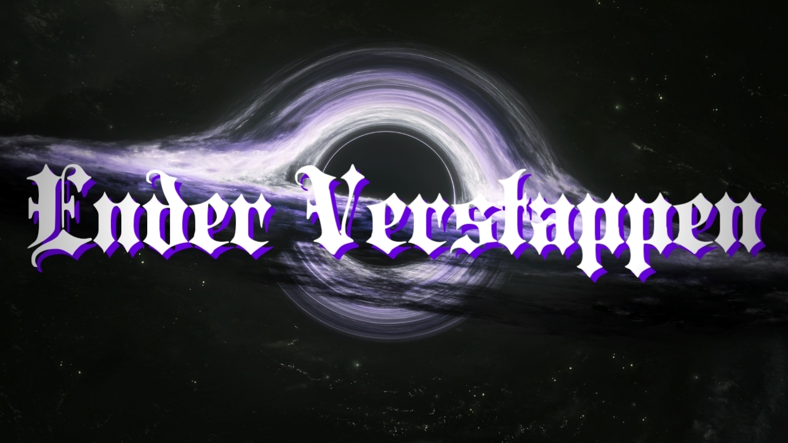

<!-- Improved compatibility of back to top link: See: https://github.com/othneildrew/Best-README-Template/pull/73 -->
<a id="readme-top"></a>

<!-- PROJECT SHIELDS -->
[![Contributors][contributors-shield]][contributors-url]
[![Forks][forks-shield]][forks-url]
[![Stargazers][stars-shield]][stars-url]
[![Issues][issues-shield]][issues-url]
[![MIT License][license-shield]][license-url]
[![WhatsApp Channel][channel-shield]][channel-url]
[![WhatsApp Group][community-shield]][community-url]

<!-- PROJECT LOGO -->
<br />
<div align="center">
  <a href="https://github.com/NDERXZ/Ender-Verstappen">
    
  </a>

  <h3 align="center">Ender Verstappen</h3>

  <p align="center">
    🚀 High Performance Multi-Device WhatsApp Bot with 800+ Features, GenAI Interactive HTML5 Rich Players, and Full Automation.
    <br />
    <a href="https://whatsapp.com/channel/0029Vb7WeqhAYlULyAOiEv2q"><strong>Join WhatsApp Channel »</strong></a>
    <br />
    <br />
    <a href="https://chat.whatsapp.com/CyqYBNPiYyNLZruhCKtsWl">Community Group</a>
    &middot;
    <a href="https://github.com/NDERXZ/Ender-Verstappen/issues/new?labels=bug&template=bug-report---.md">Report Bug</a>
    &middot;
    <a href="https://github.com/NDERXZ/Ender-Verstappen/issues/new?labels=enhancement&template=feature-request---.md">Request Feature</a>
  </p>
</div>

<!-- TABLE OF CONTENTS -->
<details>
  <summary>Table of Contents</summary>
  <ol>
    <li>
      <a href="#about-the-project">About The Project</a>
      <ul>
        <li><a href="#key-features">Key Features</a></li>
        <li><a href="#built-with">Built With</a></li>
      </ul>
    </li>
    <li>
      <a href="#getting-started">Getting Started</a>
      <ul>
        <li><a href="#prerequisites">Prerequisites</a></li>
        <li><a href="#installation">Installation</a></li>
        <li><a href="#configuration">Configuration</a></li>
      </ul>
    </li>
    <li><a href="#usage">Usage</a></li>
    <li><a href="#roadmap">Roadmap</a></li>
    <li><a href="#contributing">Contributing</a></li>
    <li><a href="#license">License</a></li>
    <li><a href="#contact">Contact</a></li>
    <li><a href="#acknowledgments">Acknowledgments</a></li>
  </ol>
</details>

<!-- ABOUT THE PROJECT -->
## About The Project

<div align="center">
  
</div>

<br />

**Ender Verstappen** is an advanced Multi-Device WhatsApp bot crafted with speed, resilience, and rich interactive capabilities at its core. Engineered on top of Baileys (`lilys-baileys`), it delivers next-generation WhatsApp messaging using **Meta AI GenAI Interactive HTML5 components** that run directly inside chat bubbles without external browser redirects.

### Why Ender Verstappen?
* **Next-Gen In-Chat Media Experience**: Listen to full Spotify and SoundCloud tracks, or watch YouTube videos with seekbar, volume control, and play/pause buttons embedded right inside WhatsApp.
* **Zero Storage Buffering**: Employs real-time binary chunk streaming over WebSockets (`wss://stream.kanara.my.id`), bypassing heavy disk I/O and saving server RAM.
* **Extensive Feature Set**: Ships with over 800+ API integrations in the Free version, ranging from AI generative assistants (Gemini & OpenAI) to media converters, downloader tools, and group management automation.
* **Lightweight & Android-Safe**: All interactive HTML payloads are strictly compressed under 25KB, fully immune to WhatsApp Android `TransactionTooLargeException` binder crashes.

<p align="right">(<a href="#readme-top">back to top</a>)</p>

### Key Features

* 🎬 **Interactive YouTube Player (`.ytp`)**: Embedded video player with responsive seekbar, fast-forward/rewind 10s, volume slider, and live buffer console.
* 🎧 **Spotify Player (`.spotify`)**: Full track streaming styled in signature Spotify neon green (`#1db954`), powered by anonymous token bootstrapping and Pathfinder GraphQL search (`spotifyscraper` architecture).
* 🟠 **SoundCloud Player (`.soundcloud` / `.sc`)**: Ambient blurred cover art background with progressive MP3 audio streaming.
* 🤖 **AI Virtual Assistant (`.ai` / `.ender`)**: Multi-turn conversational artificial intelligence powered by Google Gemini AI & OpenAI.
* 📲 **Pairing Code Authentication**: Connect seamlessly using custom 8-digit WhatsApp Pairing Codes without scanning QR codes.
* 🛡️ **Comprehensive Moderation**: Anti-link, anti-tag, auto-react, welcome/leave canvas banners, and administrative security controls.

<p align="right">(<a href="#readme-top">back to top</a>)</p>

### Built With

* [![Node.js][Node.js]][Node-url]
* [![Baileys][Baileys]][Baileys-url]
* [![JavaScript][JavaScript]][JavaScript-url]
* [![HTML5][HTML5]][HTML5-url]
* [![Google Gemini][Gemini]][Gemini-url]
* [![Axios][Axios]][Axios-url]
* [![SQLite][SQLite]][SQLite-url]
* [![FFmpeg][FFmpeg]][FFmpeg-url]

<p align="right">(<a href="#readme-top">back to top</a>)</p>

<!-- GETTING STARTED -->
## Getting Started

Follow these step-by-step instructions to get your local instance of Ender Verstappen up and running.

### Prerequisites

Ensure you have the following prerequisites installed on your system or server:
* **Node.js** (v18.x or v20.x LTS recommended)
  ```sh
  node -v
  ```
* **Git**
  ```sh
  git --version
  ```
* **FFmpeg** (Required for audio/video processing and sticker creation)
  * Linux (Ubuntu/Debian): `sudo apt install ffmpeg`
  * Windows: Download from official FFmpeg website and add to PATH.

### Installation

1. Clone the repository
   ```sh
   git clone https://github.com/NDERXZ/Ender-Verstappen.git
   cd Ender-Verstappen
   ```

2. Install NPM packages
   ```sh
   npm install
   ```

3. Configure Environment Variables (Optional)
   Create a `.env` file in the root directory:
   ```env
   GOOGLE_AI_API_KEY="your_google_gemini_api_key_here"
   OPENAI_API_KEY="your_openai_api_key_here"
   ```

### Configuration

Edit [`settings.js`](settings.js) to configure your bot credentials:
```javascript
global.owner = ["62895327468806"]          // Your WhatsApp Owner Number
global.nobot = "6287724199227"             // Your WhatsApp Bot Number
global.namaowner = "Chaidar"                // Owner Display Name
global.namaBot = "Ender Verstappen"        // Bot Display Name
global.pairingCode = "ENDERDEV"            // Custom 8-character Pairing Code
```

Start the bot:
```sh
npm start
```

When prompted in the terminal, enter your phone number to receive the pairing code, then link your WhatsApp via **Linked Devices > Link with Phone Number**.

<p align="right">(<a href="#readme-top">back to top</a>)</p>

<!-- USAGE EXAMPLES -->
## Usage

Once active, trigger commands using prefixes like `.`, `/`, or `#`:

### Interactive Media Players
* **YouTube Player**:
  ```text
  .ytp faded alan walker
  .ytp https://youtu.be/60ItHLz5WEA
  ```
* **Spotify Player**:
  ```text
  .spotify birds of a feather billie eilish
  .spotify https://open.spotify.com/track/4cOdK2wGLETKBW3PvgPWqT
  ```
* **SoundCloud Player**:
  ```text
  .sc alan walker faded
  .soundcloud https://soundcloud.com/alanwalker/faded
  ```

### AI Assistant & General Commands
* **Chat with AI**:
  ```text
  .ai jelaskan teori relativitas secara sederhana
  .ender buatkan script python untuk web scraping
  ```
* **Main Menu**:
  ```text
  .menu
  ```

<p align="right">(<a href="#readme-top">back to top</a>)</p>

<!-- ROADMAP -->
## Roadmap

- [x] WhatsApp Multi-Device connection with Pairing Code support
- [x] Interactive Meta AI GenAI HTML5 Video & Audio Players
- [x] Real-time WebSocket audio/video stream buffering (`wss://stream.kanara.my.id`)
- [x] Zero-API-key Spotify scraping via `spotifyscraper` embed & Pathfinder GraphQL
- [x] Multi-layer YouTube resolvers (`SaveNow`, `ytdlAuto`, `Cobalt`)
- [x] AI Assistant integration with Google Gemini & OpenAI
- [ ] Web-based Pterodactyl monitoring dashboard
- [ ] Multi-session cluster manager

See the [open issues](https://github.com/NDERXZ/Ender-Verstappen/issues) for a full list of proposed features (and known issues).

<p align="right">(<a href="#readme-top">back to top</a>)</p>

<!-- CONTRIBUTING -->
## Contributing

Contributions are what make the open source community such an amazing place to learn, inspire, and create. Any contributions you make are **greatly appreciated**.

If you have a suggestion that would make this better, please fork the repo and create a pull request:

1. Fork the Project
2. Create your Feature Branch (`git checkout -b feature/AmazingFeature`)
3. Commit your Changes (`git commit -m 'Add some AmazingFeature'`)
4. Push to the Branch (`git push origin feature/AmazingFeature`)
5. Open a Pull Request

Don't forget to give the project a star! ⭐

<p align="right">(<a href="#readme-top">back to top</a>)</p>

<!-- LICENSE -->
## License

Distributed under the MIT License. See `package.json` for more information.

<p align="right">(<a href="#readme-top">back to top</a>)</p>

<!-- CONTACT -->
## Contact

**Chaidar** - Creator & Lead Developer
* WhatsApp: [+62 895-3274-68806](https://wa.me/62895327468806)
* Official Channel: [WhatsApp Channel](https://whatsapp.com/channel/0029Vb7WeqhAYlULyAOiEv2q)
* Community: [Ender Verstappen Group](https://chat.whatsapp.com/CyqYBNPiYyNLZruhCKtsWl)
* Project Repository: [https://github.com/NDERXZ/Ender-Verstappen](https://github.com/NDERXZ/Ender-Verstappen)

<p align="right">(<a href="#readme-top">back to top</a>)</p>

<!-- ACKNOWLEDGMENTS -->
## Acknowledgments

Special thanks to the open-source projects, APIs, and libraries that made this project possible:

* [WhiskeySockets / Baileys](https://github.com/WhiskeySockets/Baileys)
* [SpotifyScraper by AliAkhtari78](https://github.com/AliAkhtari78/SpotifyScraper)
* [Cobalt API](https://cobalt.tools)
* [SaveNow Media Services](https://p.savenow.to)
* [Google Generative AI SDK](https://ai.google.dev/)
* [Best-README-Template by othneildrew](https://github.com/othneildrew/Best-README-Template)
* [Img Shields](https://shields.io)

<p align="right">(<a href="#readme-top">back to top</a>)</p>

<!-- MARKDOWN LINKS & IMAGES -->
[contributors-shield]: https://img.shields.io/github/contributors/NDERXZ/Ender-Verstappen.svg?style=for-the-badge
[contributors-url]: https://github.com/NDERXZ/Ender-Verstappen/graphs/contributors
[forks-shield]: https://img.shields.io/github/forks/NDERXZ/Ender-Verstappen.svg?style=for-the-badge
[forks-url]: https://github.com/NDERXZ/Ender-Verstappen/network/members
[stars-shield]: https://img.shields.io/github/stars/NDERXZ/Ender-Verstappen.svg?style=for-the-badge
[stars-url]: https://github.com/NDERXZ/Ender-Verstappen/stargazers
[issues-shield]: https://img.shields.io/github/issues/NDERXZ/Ender-Verstappen.svg?style=for-the-badge
[issues-url]: https://github.com/NDERXZ/Ender-Verstappen/issues
[license-shield]: https://img.shields.io/badge/License-MIT-green.svg?style=for-the-badge
[license-url]: https://github.com/NDERXZ/Ender-Verstappen/blob/master/package.json
[channel-shield]: https://img.shields.io/badge/WhatsApp-Channel-25D366?style=for-the-badge&logo=whatsapp&logoColor=white
[channel-url]: https://whatsapp.com/channel/0029Vb7WeqhAYlULyAOiEv2q
[community-shield]: https://img.shields.io/badge/WhatsApp-Community-128C7E?style=for-the-badge&logo=whatsapp&logoColor=white
[community-url]: https://chat.whatsapp.com/CyqYBNPiYyNLZruhCKtsWl
[Node.js]: https://img.shields.io/badge/Node.js-339933?style=for-the-badge&logo=nodedotjs&logoColor=white
[Node-url]: https://nodejs.org/
[Baileys]: https://img.shields.io/badge/Baileys-Multi_Device-25D366?style=for-the-badge&logo=whatsapp&logoColor=white
[Baileys-url]: https://github.com/WhiskeySockets/Baileys
[JavaScript]: https://img.shields.io/badge/JavaScript-F7DF1E?style=for-the-badge&logo=javascript&logoColor=black
[JavaScript-url]: https://developer.mozilla.org/en-US/docs/Web/JavaScript
[HTML5]: https://img.shields.io/badge/HTML5-E34F26?style=for-the-badge&logo=html5&logoColor=white
[HTML5-url]: https://developer.mozilla.org/en-US/docs/Web/HTML
[Gemini]: https://img.shields.io/badge/Google_Gemini-8E75C2?style=for-the-badge&logo=google&logoColor=white
[Gemini-url]: https://ai.google.dev/
[Axios]: https://img.shields.io/badge/Axios-5A29E4?style=for-the-badge&logo=axios&logoColor=white
[Axios-url]: https://axios-http.com/
[SQLite]: https://img.shields.io/badge/SQLite-003B57?style=for-the-badge&logo=sqlite&logoColor=white
[SQLite-url]: https://www.sqlite.org/
[FFmpeg]: https://img.shields.io/badge/FFmpeg-007808?style=for-the-badge&logo=ffmpeg&logoColor=white
[FFmpeg-url]: https://ffmpeg.org/
